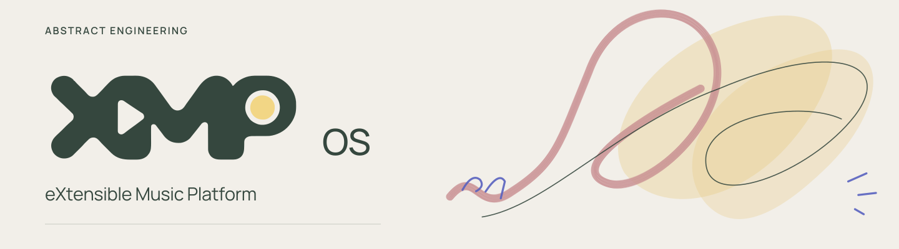
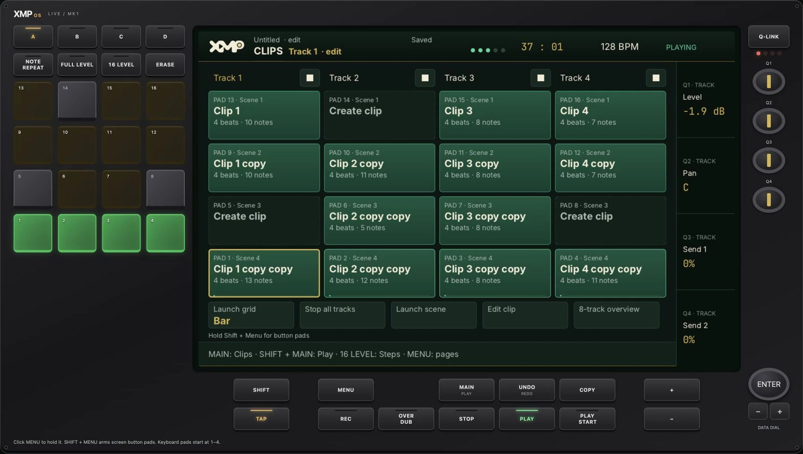
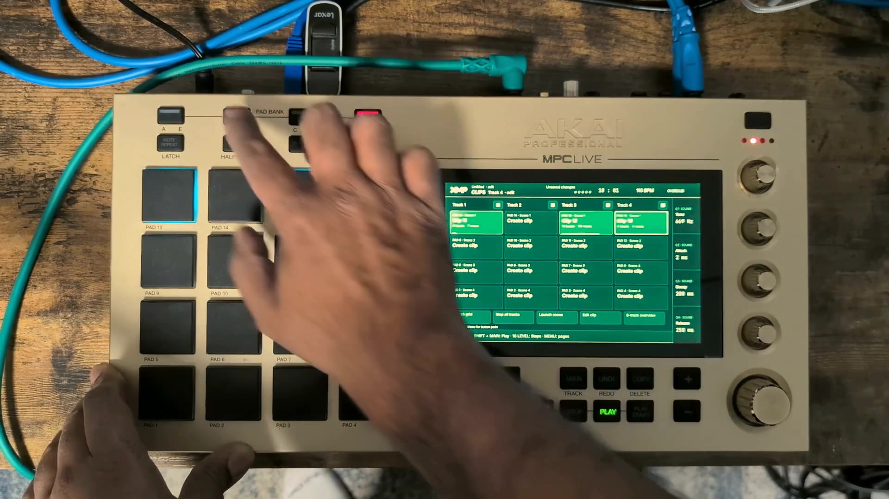

[](https://abstracteng.com/)

# XMP OS

**From a loop to somewhere new.**

An idea arrives as a rhythm, a melody, a feeling. XMP OS is an extensible, clip-based music-making environment for the MPC Live Mk1, and an open-source foundation for the instrument you want to build.

Lay down drums, bass, keys and samples. Try a variation. Launch a scene. Follow the idea while it is still taking shape.

**[Try XMP OS in your browser ↗](https://abstracteng.com/xmpos/)** · **[Read the manual ↗](https://abstracteng.com/xmpos/manual/)** · **[Build with XMP ↓](#make-it-your-own)**

Created by **[sandeshm](https://github.com/sandeshm)** at **[Abstract Engineering](https://abstracteng.com/)**. A community developer baseline. Initial hardware profile: **MPC Live Mk1 / ACV8, MPC OS 3.10.1**. [Release status](RELEASE.md) · [Known limits](docs/known-issues.md).

[](https://abstracteng.com/#xmpos)

_Acid Circuit — a beat taking shape in the browser Device view. [Watch the website demo ↗](https://abstracteng.com/#xmpos) or [play with the web client ↗](https://abstracteng.com/xmpos/). The hardware session is further down this page._

## Start with a sound.

XMP brings pads, clips, scenes, sound shaping and mixing into one musical workflow. Start with the included original XMP sounds and cleared content, build a small pattern, then explore what changes when you add another part.

| Find the idea                      | Follow it                                     | Keep it                                                     |
| ---------------------------------- | --------------------------------------------- | ----------------------------------------------------------- |
| Play a kit or synth from the pads. | Edit a clip, try a variation, launch a scene. | Stop, wait for **Saved on stick**, and reopen your project. |

The [quick start](docs/community-quickstart.md) takes you through the basic play/edit/save loop. The [manual and video lessons](https://abstracteng.com/xmpos/manual/) introduce the controls and build a piece of music step by step.

## Make it your own.

**The framework is as much the project as the instrument.** We have done the foundational work—audio, sequencing, hardware controls, project storage, build tools and a shared touchscreen—so other developers can focus on interfaces, instruments and the musical experience.

Build an instrument that works the way you think. Change how a page behaves. Explore a different workflow. The existing XMP app is a starting point you can study, extend and contribute to.

| What you want to build                       | Where to begin                                                                                                                                       |
| -------------------------------------------- | ---------------------------------------------------------------------------------------------------------------------------------------------------- |
| An original instrument or effect             | [SDK manual and examples](docs/sdk/README.md). Bounded declarative modules, offline tools and a worked customization.                                |
| A custom interface, app or workflow          | [Developer guide](docs/developer-guide.md) and the [shared C++ touchscreen](native/include/xmp/live_ui.hpp). Full UI/app changes use a source build. |
| A core improvement or a future hardware port | [Contribution guide](CONTRIBUTING.md), [core model](packages/core) and [compatibility/port scope](docs/compatibility.md).                            |

The native touchscreen is shared across the Live, emulator and browser through WebAssembly. Platform adapters supply display, input, audio and storage. The installed SDK compatibility manifest describes its API, ABI and project schema; full native apps and UI changes use the source-build route.

## Watch a loop take shape.

A hands-on session making a beat on the **MPC Live Mk1**: editing the clip, building the loop and letting it play. This is the full **2:07 edited recording**, including the opening beat editing, with the finished green/gold grade, selective screen sharpening and normalized audio.

[](https://github.com/AbstractEng/XMPOS/releases/download/showcase/XMP-OS-Beat-Final-Share.mp4)

**[Watch the full hardware video ↗](https://github.com/AbstractEng/XMPOS/releases/download/showcase/XMP-OS-Beat-Final-Share.mp4)**

_A real hardware session on the Live Mk1, from the first clip edits through playback._

## Bring XMP to your Live.

XMP OS runs from a USB key after a one-time loader setup. The initial profile is **MPC Live Mk1 / ACV8, already running MPC OS 3.10.1**. The graphical installer source brings USB preparation and local loader/recovery setup into one workflow; each write is confirmed with **XMPOS**.

On a fresh key, installer preparation loads **Acid Circuit**, the acid-house song from the demo video. Boot and press **PLAY** to hear the arrangement. Existing projects and recovery files stay intact.

The source, SDK and development tools are here now. Packaged hardware installers are being finalized separately; [release information](RELEASE.md) tracks their availability. You supply the official signed 3.10.1 updater, and Akai-derived files stay local.

Read [installation](docs/install-live-mk1.md), [returning to stock](docs/recover-live-mk1.md) and [the quick start](docs/community-quickstart.md). Stop and wait for **Saved on stick** before restarting or powering off. Removing the key boots stock through the loader; full restoration removes it. Detailed compatibility and measured scope are in [release information](RELEASE.md) and [known issues](docs/known-issues.md).

<details>
<summary><strong>Hardware compatibility and starting firmware</strong></summary>

<!-- BEGIN GENERATED COMPATIBILITY -->
Public hardware installation is not yet cleared. Live Mk1 is the tested candidate; One models are planned ports.

| Model              | Board         | Status                                                            | Starting firmware                                          |
| ------------------ | ------------- | ----------------------------------------------------------------- | ---------------------------------------------------------- |
| MPC Live Mk1       | inmusic,acv8  | Hardware-tested candidate; public installation pending            | 3.10.1 only                                                |
| MPC One (original) | inmusic,acva  | Planned port; installation disabled; no XMP hardware tests        | Gen 1 3.10.1 proposed; not qualified                       |
| MPC One+           | inmusic,acva2 | Planned port; installation disabled; no XMP hardware tests        | Gen 1 3.10.1 proposed; not qualified                       |
| MPC One G2         | Unverified    | Separate Gen 2 port; installation disabled; no XMP hardware tests | Separate Gen 2 firmware family; never use this Gen 1 image |
| Akai Force         | inmusic,ada2  | Protected; excluded from all installation and device testing      | None                                                       |

Stop installation when any required fact is unknown, differs or is ambiguous. Keep the instrument on stock firmware; do not substitute a Live image, bypass a guard or probe another model with Live tools.
<!-- END GENERATED COMPATIBILITY -->

One/One+ are planned community ports; One G2 needs a separate investigation. Force is excluded. See [compatibility](docs/compatibility.md) for the exact model/host profile.

</details>

## Build without an instrument.

Use **Node 24**, npm, Python 3 and a C/C++17 compiler. From the source checkout:

```sh
nvm use
npm run bootstrap
npm run doctor
npm run dev
```

`bootstrap` runs `npm ci` and installs pinned CMake/Ninja into `.venv`. Open the local URL to work on the browser. Start with the [developer guide](docs/developer-guide.md), [SDK examples](docs/sdk/examples.md) or [contributor guide](CONTRIBUTING.md). Docker is optional for the tested Mac userspace route and is not needed for SDK work.

<details>
<summary><strong>Run the core checks</strong></summary>

```sh
npm run check
npm run parity -- --maxWorkers=1
npm run inventory:test
npm run native:test
```

Run affected SDK/native/browser checks when changing those paths. CI workflows are manual-only; retain matching build/test evidence. Follow [AGENTS.md](AGENTS.md) for hardware boundaries.

</details>

## Help shape what comes next.

Build an original sound. Improve a screen. Fix a reproducible bug. Make a tutorial. Help plan and test a separately qualified port. Small, focused contributions are welcome.

[Open an issue](https://github.com/AbstractEng/XMPOS/issues) · [Send a pull request](https://github.com/AbstractEng/XMPOS/pulls) · [Read the contribution guide](CONTRIBUTING.md) · [Report a security issue](SECURITY.md)

Fork the repository and open a pull request. **[@sandeshm](https://github.com/sandeshm)** reviews and merges contributions.

Include the source/SDK version, a small original reproduction and the checks you ran. Keep credentials, device identifiers, firmware and personal projects out of reports.

---

An independent project by **[Abstract Engineering](https://abstracteng.com/)**. Original XMP code is **[Apache-2.0](LICENSE)**; SDK example templates retain their MIT notices. [Third-party notices and source requirements](docs/licensing/README.md) apply. XMP is not affiliated with or endorsed by Akai Professional or inMusic.

[Website](https://abstracteng.com/) · [Web client](https://abstracteng.com/xmpos/) · [Manual](https://abstracteng.com/xmpos/manual/) · [Release status](RELEASE.md)
