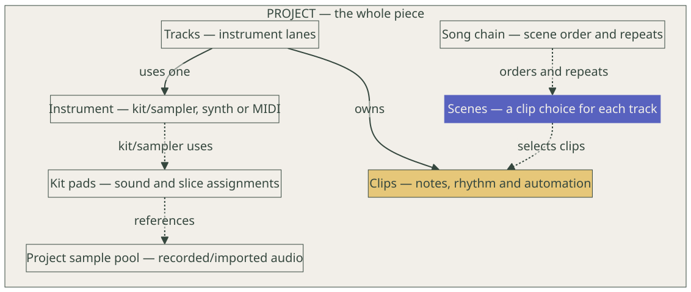

# XMP OS music lessons

Abstract Engineering · Engineering for human expression

## Practice files

- [Practice project](../../apps/studio/public/manual-media/practice-groove.xmpsong), with original samples and the actual saved course project.
- [Original loop WAV for slicing](../../apps/studio/public/manual-media/first-groove.wav).
- [Handclap WAV](../../apps/studio/public/manual-media/sound-swap/Handclap.wav) for lesson 13.

## How XMP fits together

Tracks use instruments and own clips. Scenes choose clips; the song chain orders scenes. Empty slots stop their tracks. Kit pads refer to the project sample pool.

## 1. Meet your new workflow

**Goal:** Find Clips, Play, Steps and Sound using the hardware controls.

**Before starting:** Start in a fresh project with the original drum kit.

[Watch (42 seconds)](https://abstracteng.com/xmpos/manual-media/01-navigation.mp4) · [Captions](../../apps/studio/public/manual-media/01-navigation.vtt)

1. **Start with the music.** MAIN opens Clips: tracks across, scenes down. Let's find our way around. Main brings you to Clips: tracks across, scenes down. This is where your parts come together.

2. **Use MENU and a pad.** MENU + PAD 13 → Play. The top row opens track pages. Hold Menu and press pad thirteen for Play. The top row takes you to the selected track's pages.

3. **Pick a track, play a sound.** A selects track 1. PAD 1 plays its kick. A selects track one. Try pad one. Those same sixteen pads will play sounds, enter steps, or launch clips, depending on the page.

4. **Go straight to Steps.** 16 LEVEL opens Steps. MAIN returns to Clips. Sixteen Level takes you straight to Steps. Main gets you back to Clips. Your notes stay with the project.

5. **Shape the sound.** MENU + PAD 16 → Sound. PAD 13 chooses Kit; Q-LINK changes the knob page. Hold Menu and press pad sixteen for Sound. Choose Kit with pad thirteen, then press Q-Link and read the four knob labels.

6. **Ready for a beat.** MAIN → Clips. Next: build a loop with the pads. That's enough navigation to start making something. Back to Main, and let's put a beat on those pads.

**Live / web note:** The touchscreen and controls use the same C++ interface in the browser and on the Live. Hold MENU or SHIFT with the next control on hardware. In the browser, click the modifier then the control. For Browse, click SHIFT then MENU twice to press and release it. File access uses the browser library or your Live USB stick. These recordings use the browser build; no hardware was operated.

## 2. A beat without poking the screen

**Goal:** Create a 16-step kick and snare loop with the pads.

**Before starting:** Start in a fresh project with the original drum kit.

[Watch (40 seconds)](https://abstracteng.com/xmpos/manual-media/02-first-beat.mp4) · [Captions](../../apps/studio/public/manual-media/02-first-beat.vtt)

1. **Create the first clip.** A → 16 LEVEL → press DATA DIAL to create a clip. Start on a fresh practice project. Press A, Sixteen Level, then the data dial to create your first clip.

2. **Choose the kick.** Hold SHIFT + PAD 1. Release SHIFT before entering steps. Hold Shift and hit pad one to select the kick. Release Shift. Now the pads enter steps instead of changing sounds.

3. **Four on the floor.** PAD 13, 9, 5, 1 = steps 1, 5, 9, 13. Time runs from the top row down. Pads thirteen, nine, five, and one give us four steady kicks.

4. **Add the backbeat.** SHIFT + PAD 2 chooses Snare. PAD 9 and 1 enter its hits. Shift and pad two selects the snare. Release Shift, then hit pads nine and one. There's your backbeat.

5. **Hear the loop.** PLAY START plays from the beginning. Press Play Start. Simple, but it already gives us something to build on.

6. **Keep your work.** STOP. Wait for Saved before leaving the session. Press Stop and wait for Saved. On the Live, look for Saved on stick before restarting or switching off.

**Live / web note:** The touchscreen and controls use the same C++ interface in the browser and on the Live. Hold MENU or SHIFT with the next control on hardware. In the browser, click the modifier then the control. For Browse, click SHIFT then MENU twice to press and release it. File access uses the browser library or your Live USB stick. These recordings use the browser build; no hardware was operated.

## 3. Make the hats breathe

**Goal:** Add eighth-note hats and vary a hit's velocity.

**Before starting:** Continue the project from the preceding lesson.

[Watch (34 seconds)](https://abstracteng.com/xmpos/manual-media/03-hats-groove.mp4) · [Captions](../../apps/studio/public/manual-media/03-hats-groove.vtt)

1. **Choose the hat.** In Steps, hold SHIFT + PAD 3 to select the closed hat. Back in Steps, hold Shift and pad three for the closed hat. We're adding to the beat, keeping the kick and snare.

2. **Fill the first half.** PAD 13, 15, 9, 11 = steps 1, 3, 5, 7. Try eighth notes. Pads thirteen, fifteen, nine, and eleven fill the first half of the bar.

3. **Finish the bar.** PAD 5, 7, 1, 3 = steps 9, 11, 13, 15. Then pads five, seven, one, and three finish it. The last hit you entered is selected.

4. **Soften the last hat.** Read the Q-Link labels. On the Step page, turn Q1 down. With the Step knob page showing, turn Q one down. That last hat gets softer, which gives the loop a little movement.

5. **Listen to the difference.** PLAY START. Hear the softer hat before the loop returns. Play Start. Listen for the softer hit just before the bar comes round again.

6. **Compare safely.** STOP → UNDO → SHIFT + UNDO to redo. Stop, Undo, then Shift and Undo to bring it back. Keep the version that feels better to you.

**Live / web note:** The touchscreen and controls use the same C++ interface in the browser and on the Live. Hold MENU or SHIFT with the next control on hardware. In the browser, click the modifier then the control. For Browse, click SHIFT then MENU twice to press and release it. File access uses the browser library or your Live USB stick. These recordings use the browser build; no hardware was operated.

## 4. Give the drums a bass line

**Goal:** Choose a synth for a new track and enter pitched notes with the pads.

**Before starting:** Continue the project from the preceding lesson.

[Watch (35 seconds)](https://abstracteng.com/xmpos/manual-media/04-synth.mp4) · [Captions](../../apps/studio/public/manual-media/04-synth.vtt)

1. **Choose a new track.** B selects track 2. MENU + PAD 16 opens its machine choices. Let's give those drums some company. B selects track two. Hold Menu and press pad sixteen for Sound, with the machine choices for this new track.

2. **Make it a synth.** PAD 15 chooses Synth. SHIFT + PAD 1 auditions a note. Choose Synth with pad fifteen. Hold Shift and play pad one to hear the current sound.

3. **Create its pattern.** 16 LEVEL → press DATA DIAL. SHIFT + PAD 1 selects C3. Sixteen Level, then press the dial to create a clip. Shift and pad one selects C three for editing.

4. **Give it some space.** PAD 13 and 5 enter steps 1 and 9. Put notes on pads thirteen and five. That's steps one and nine. Leave some space for the drums.

5. **Try another pitch.** SHIFT + PAD 3 selects E3; PAD 7 enters step 11. Shift and pad three selects E three. Release Shift and hit pad seven for a little answer on step eleven.

6. **Hear the scene.** MAIN → DATA DIAL launches the selected scene. STOP finishes. Main, then press the dial to hear the scene together. Stop when you're done. A few notes can go a long way.

**Live / web note:** The touchscreen and controls use the same C++ interface in the browser and on the Live. Hold MENU or SHIFT with the next control on hardware. In the browser, click the modifier then the control. For Browse, click SHIFT then MENU twice to press and release it. File access uses the browser library or your Live USB stick. These recordings use the browser build; no hardware was operated.

## 5. Make a variation, keep the original

**Goal:** Copy a drum clip and change the copy.

**Before starting:** Continue the project from the preceding lesson.

[Watch (34 seconds)](https://abstracteng.com/xmpos/manual-media/05-variation.mp4) · [Captions](../../apps/studio/public/manual-media/05-variation.vtt)

1. **Focus the original.** MAIN → A. Keep scene 1 selected. Let's make a second version without losing the first. Main, then A puts the focus back on the drums.

2. **Copy to the next scene.** COPY → PAD 9 copies into track 1, scene 2. Press Copy, then pad nine. Your drum clip now has an independent copy in the next scene.

3. **Open the copy.** 16 LEVEL. SHIFT + PAD 2 selects the snare. Open Steps with Sixteen Level, and choose the snare with Shift and pad two.

4. **Add a little push.** PAD 3 adds a snare on step 15. Pad three adds a snare just before the bar turns round. A small change is enough to make a different section.

5. **Try it both ways.** UNDO removes the new hit. SHIFT + UNDO restores it. Undo takes that hit out. Shift and Undo brings it back. The original clip hasn't changed.

6. **Back to the clips.** MAIN shows both versions in the same track. Press Main. Both versions are there, ready to launch. Next we'll play them as parts of a track.

**Live / web note:** The touchscreen and controls use the same C++ interface in the browser and on the Live. Hold MENU or SHIFT with the next control on hardware. In the browser, click the modifier then the control. For Browse, click SHIFT then MENU twice to press and release it. File access uses the browser library or your Live USB stick. These recordings use the browser build; no hardware was operated.

## 6. Play the clip grid

**Goal:** Launch parts and scenes with the 4×4 pads.

**Before starting:** Continue the project from the preceding lesson.

[Watch (37 seconds)](https://abstracteng.com/xmpos/manual-media/06-scenes.mp4) · [Captions](../../apps/studio/public/manual-media/06-scenes.vtt)

1. **Read the pad window.** Top row: scene 1. PAD 13 launches track 1's first clip. In Clips, the pads are a four by four window. The top row is scene one. Pad thirteen launches its drum clip.

2. **Bring in the bass.** PAD 14 launches track 2 in the same scene. Pad fourteen brings in the bass. Each column is a track, so you can build things up one part at a time.

3. **Switch the drums.** PAD 9 launches the drum variation in scene 2. Pad nine switches the drums to the next scene. Watch the queued state: the change lands on the launch grid.

4. **Take a part out.** Press PAD 9 again to stop that playing clip. Press the playing clip's pad again to stop that track. You can leave the other parts running.

5. **Launch a whole scene.** Press DATA DIAL to launch the selected scene. Press the data dial to launch the whole selected scene. Empty slots stop their tracks, so a scene can be a breakdown too.

6. **Reach the other scenes.** + / − moves four scenes. STOP stops everything. Plus and minus move the pad window four scenes at a time. Press Stop to finish the jam.

**Live / web note:** The touchscreen and controls use the same C++ interface in the browser and on the Live. Hold MENU or SHIFT with the next control on hardware. In the browser, click the modifier then the control. For Browse, click SHIFT then MENU twice to press and release it. File access uses the browser library or your Live USB stick. These recordings use the browser build; no hardware was operated.

## 7. Turn the parts into a song

**Goal:** Use pads to build a scene chain.

**Before starting:** Continue the project from the preceding lesson.

[Watch (35 seconds)](https://abstracteng.com/xmpos/manual-media/07-song.mp4) · [Captions](../../apps/studio/public/manual-media/07-song.vtt)

1. **Open Song.** MENU + PAD 10 opens Song. You've got parts. Let's give them an order. Hold Menu and press pad ten for Song.

2. **Add the first section.** PAD 13 adds scene 1 after the selected block. Pad thirteen adds scene one. In Song, the pads represent scenes instead of individual clips.

3. **Add a change.** PAD 14 adds scene 2, then PAD 13 returns to scene 1. Pad fourteen adds scene two, and pad thirteen brings us back to scene one. A simple beginning, change, and return.

4. **Let a section run.** Q1 adjusts repeats for the selected block. Turn Q one to give the selected block another repeat. You can let a good part sit for a little longer.

5. **Play the chain.** PLAY START plays the song from the beginning. Press Play Start to hear the chain from the beginning. The blocks tell you which scene comes next.

6. **Keep it editable.** STOP. UNDO reverses the last song edit. Stop when you've heard enough. The song stays editable, and Undo can take back the last arrangement change.

**Live / web note:** The touchscreen and controls use the same C++ interface in the browser and on the Live. Hold MENU or SHIFT with the next control on hardware. In the browser, click the modifier then the control. For Browse, click SHIFT then MENU twice to press and release it. File access uses the browser library or your Live USB stick. These recordings use the browser build; no hardware was operated.

## 8. Make room for each part

**Goal:** Select, balance, mute and solo tracks using hardware.

**Before starting:** Continue the project from the preceding lesson.

[Watch (34 seconds)](https://abstracteng.com/xmpos/manual-media/08-mix.mp4) · [Captions](../../apps/studio/public/manual-media/08-mix.vtt)

1. **Open the mixer.** MENU + PAD 11 → Mix. PAD 14 selects track 2. Hold Menu and press pad eleven for Mix. The top two pad rows select tracks. Pad fourteen selects the bass on track two.

2. **Set the balance.** Q1 controls the selected track's level. Turn Q one down a little. We're making room for the drums, rather than making everything louder.

3. **Hear the mix.** PLAY START. Keep an eye on the selected strip. Play Start. Listen to the drums and bass together while you watch their strips.

4. **Mute the drums.** PAD 5 mutes track 1; press again to bring it back. Pad five mutes the drums. Press it again to bring them back. The bottom two rows are your mute controls.

5. **Hear one part alone.** SHIFT + PAD 5 solos track 1. Repeat to leave solo. Hold Shift and pad five to solo the drums. Do it again to hear the full mix.

6. **Save the balance.** STOP, then wait for Saved. Press Stop and let the save finish. That's a useful mix check without leaving the hardware controls.

**Live / web note:** The touchscreen and controls use the same C++ interface in the browser and on the Live. Hold MENU or SHIFT with the next control on hardware. In the browser, click the modifier then the control. For Browse, click SHIFT then MENU twice to press and release it. File access uses the browser library or your Live USB stick. These recordings use the browser build; no hardware was operated.

## 9. Play a part into the track

**Goal:** Record and overdub notes from the pads.

**Before starting:** Continue the project from the preceding lesson.

[Watch (35 seconds)](https://abstracteng.com/xmpos/manual-media/09-record.mp4) · [Captions](../../apps/studio/public/manual-media/09-record.vtt)

1. **Give the part a track.** C → MENU + PAD 16 → PAD 15 chooses Synth on track 3. Let's play a part instead of entering steps. C selects track three. Hold Menu and press pad sixteen, then choose Synth with pad fifteen.

2. **Find a phrase.** SHIFT + MAIN opens Play. Try PAD 1, 3 and 5. Shift and Main opens Play. Try pads one, three, and five. Keep it short enough to remember.

3. **Start a take.** REC starts recording. Watch the count-in before playing. Press Record. Watch the count-in, and let the first bar settle before you play.

4. **Play the phrase.** Play PAD 1, 3 and 5, then REC to finish the take. Play that little phrase on one, three, and five. Press Record again to finish the take and turn it into a clip.

5. **Add one more note.** OVER DUB adds to the playing clip. PAD 7 adds a note. Press Overdub and add pad seven. Press Overdub again when you've added enough.

6. **Check the result.** STOP → 16 LEVEL shows the recorded notes. UNDO is available. Stop, then Sixteen Level shows what you played. If a take doesn't work, Undo gives you another go.

**Live / web note:** The touchscreen and controls use the same C++ interface in the browser and on the Live. Hold MENU or SHIFT with the next control on hardware. In the browser, click the modifier then the control. For Browse, click SHIFT then MENU twice to press and release it. File access uses the browser library or your Live USB stick. These recordings use the browser build; no hardware was operated.

## 10. Change the kit, keep the beat

**Goal:** Load a whole kit from Browse without rewriting the pattern.

**Before starting:** Continue the project from the preceding lesson.

[Watch (37 seconds)](https://abstracteng.com/xmpos/manual-media/10-library.mp4) · [Captions](../../apps/studio/public/manual-media/10-library.vtt)

1. **Go to the drum sound.** A → MENU + PAD 16 opens the drum track's Sound page. Want a different drum character? Press A, then hold Menu and press pad sixteen. We're changing the sounds, keeping the beat.

2. **Open Browse.** SHIFT + MENU opens Browse. Shift and Menu opens Browse. The library is where your samples, kits, and saved projects live.

3. **Show the kits.** In Browse, SHIFT + PAD 11 selects Kits. Hold Shift and pad eleven to show Kits. The pad labels on screen tell you what each library shortcut does.

4. **Choose and load.** PAD 14 selects the second listed kit. Press DATA DIAL to load. Pad fourteen selects the second kit in this library. Press the data dial to load it onto the selected track.

5. **Hear the same notes.** MAIN → PAD 13 plays the first drum clip with the new kit. Back to Main, then pad thirteen. Same pattern, different kit. That can change the whole feel of a part.

6. **Compare the change.** STOP → UNDO compares the old kit; SHIFT + UNDO restores the new one. Stop, Undo to compare, and Shift Undo to bring the new kit back. The other tracks keep their sounds.

**Live / web note:** The touchscreen and controls use the same C++ interface in the browser and on the Live. Hold MENU or SHIFT with the next control on hardware. In the browser, click the modifier then the control. For Browse, click SHIFT then MENU twice to press and release it. File access uses the browser library or your Live USB stick. These recordings use the browser build; no hardware was operated.

## 11. Shape one drum sound

**Goal:** Open a pad's sample and adjust its trim and tuning.

**Before starting:** Continue the project from the preceding lesson.

[Watch (34 seconds)](https://abstracteng.com/xmpos/manual-media/11-sampling.mp4) · [Captions](../../apps/studio/public/manual-media/11-sampling.vtt)

1. **Choose the sound.** A → MENU + PAD 16 → PAD 5 selects the clap. Let's make one sound fit the track. On track one, open Sound and play pad five to select its clap.

2. **Open the waveform.** Press DATA DIAL to edit the selected pad's sample. Press the data dial to open that pad's sample. Now you can see the waveform you're working on.

3. **Trim the beginning.** Q1 adjusts Start. Keep the attack you want to hear. Turn Q one to adjust the start. Take off a little space, but keep the attack that gives the sound its punch.

4. **Tune it down.** Q3 adjusts Tune. PAD 5 auditions the edited sound. Q three changes the tuning. Try a little lower, then play pad five to hear the edit.

5. **Keep the edit.** Press DATA DIAL to keep it. UNDO can restore the original. Press the dial to keep the edit. You're changing this track's sound, and Undo can restore it.

6. **Hear it in context.** SHIFT + MAIN → PAD 5 auditions the saved sound. Shift and Main takes you to Play. Try pad five again. Small sample edits can make a kit feel like your own.

**Live / web note:** The touchscreen and controls use the same C++ interface in the browser and on the Live. Hold MENU or SHIFT with the next control on hardware. In the browser, click the modifier then the control. For Browse, click SHIFT then MENU twice to press and release it. File access uses the browser library or your Live USB stick. These recordings use the browser build; no hardware was operated.

## 12. Save it, then prove it opens

**Goal:** Save a named project copy and reopen it from Browse.

**Before starting:** Continue the project from the preceding lesson.

[Watch (35 seconds)](https://abstracteng.com/xmpos/manual-media/12-save-export.mp4) · [Captions](../../apps/studio/public/manual-media/12-save-export.vtt)

1. **Finish the save.** STOP, then wait for Saved. Live: Saved on stick. Before leaving a session, press Stop and wait for Saved. On hardware, the message is Saved on stick.

2. **Open Project.** MENU + PAD 5 opens Project. PAD 15 saves the current project. Hold Menu and press pad five for Project. Pad fifteen saves the current project.

3. **Keep a named copy.** PAD 16 opens Save as. Enter GROOVE on the on-screen keyboard. Pad sixteen opens Save as. Give this version a name, so you've got something easy to find in Browse.

4. **Confirm the name.** PAD 14 confirms the name. Wait for the save result. Pad fourteen confirms the name. Wait for the save result before moving on.

5. **Reopen the copy.** In Project, PAD 14 opens saved projects. PAD 13 selects the first; DATA DIAL loads it. In Project, pad fourteen opens saved projects. Select the copy with pad thirteen, then press the dial to load it.

6. **Your music is still there.** MAIN shows the reopened clips. Web: Download saved project keeps a file copy. Main brings back the clips. In the browser, Download saved project also gives you a file copy. Now you know the project opens again.

**Live / web note:** The touchscreen and controls use the same C++ interface in the browser and on the Live. Hold MENU or SHIFT with the next control on hardware. In the browser, click the modifier then the control. For Browse, click SHIFT then MENU twice to press and release it. File access uses the browser library or your Live USB stick. These recordings use the browser build; no hardware was operated.

## 13. Swap the snare for a clap

**Goal:** Replace one pad sample from Browse while keeping its notes.

**Before starting:** Continue the project from the preceding lesson.

[Watch (40 seconds)](https://abstracteng.com/xmpos/manual-media/13-drum-sounds.mp4) · [Captions](../../apps/studio/public/manual-media/13-drum-sounds.vtt)

1. **Pick the track and pad.** A → SHIFT + MAIN → PAD 2 selects the snare. Let's swap the snare for a clap, without touching the pattern. Press A, Shift Main, then pad two.

2. **Open the sample library.** SHIFT + MENU → SHIFT + PAD 10: Samples. SHIFT + PAD 5: Search NEW. Shift Menu opens Browse. Shift and pad ten shows Samples; Shift and pad five opens Search. Enter NEW and confirm with pad fourteen.

3. **Select the replacement.** Hold SHIFT + PAD 13 to select the first listed sample. Hold Shift and pad thirteen to select the first sample in this prepared library: the tutorial clap.

4. **Listen before loading.** SHIFT + PLAY auditions the selected sample. Shift and Play auditions it. You can check the sound before assigning it to the pad.

5. **Load it onto the pad.** PAD 2 confirms the snare as the load target. DATA DIAL loads the clap. Pad two selects the snare as our load target. Press the dial to load the clap. Its notes stay where they were.

6. **Hear the backbeat.** MAIN → PAD 13 plays the clip. STOP finishes. Back to Main and pad thirteen. Hear how the new backbeat changes the groove. Stop when you're done; Undo can restore the snare.

**Live / web note:** The touchscreen and controls use the same C++ interface in the browser and on the Live. Hold MENU or SHIFT with the next control on hardware. In the browser, click the modifier then the control. For Browse, click SHIFT then MENU twice to press and release it. File access uses the browser library or your Live USB stick. These recordings use the browser build; no hardware was operated.

## 14. Find a synth sound that fits

**Goal:** Choose synth presets from the physical pad grid.

**Before starting:** Continue the project from the preceding lesson.

[Watch (40 seconds)](https://abstracteng.com/xmpos/manual-media/14-synth-sounds.mp4) · [Captions](../../apps/studio/public/manual-media/14-synth-sounds.vtt)

1. **Open the synth.** B → MENU + PAD 16 opens track 2's synth Sound page. Let's try a different colour for the bass. Press B, then hold Menu and press pad sixteen for Sound.

2. **Pick a preset.** PAD 14 selects the second preset on the current page. The whole pad grid selects presets here. Pad fourteen chooses the second one on the current page.

3. **Play without changing it.** Hold SHIFT + PAD 1, 3 and 5 to audition notes. Hold Shift while playing pads one, three, and five. That lets you hear the sound without choosing another preset.

4. **Try the next bank.** + / − changes the preset bank; DATA DIAL selects a highlighted preset. Plus and minus move between preset banks. You can also turn the data dial to browse and press it to choose.

5. **Compare with the pattern.** MAIN → DATA DIAL launches the scene with the new sound. Main and the data dial let you hear the sound with the rest of the scene. Listen for whether it fits the part.

6. **Keep the useful version.** STOP. Preset changes are undoable. Press Stop. A preset replaces that sound's current settings, so use Undo if you prefer what you had before.

**Live / web note:** The touchscreen and controls use the same C++ interface in the browser and on the Live. Hold MENU or SHIFT with the next control on hardware. In the browser, click the modifier then the control. For Browse, click SHIFT then MENU twice to press and release it. File access uses the browser library or your Live USB stick. These recordings use the browser build; no hardware was operated.

## 15. Choose what a track becomes

**Goal:** Choose Kit, Sampler, Synth or MIDI with the pads.

**Before starting:** Continue the project from the preceding lesson.

[Watch (45 seconds)](https://abstracteng.com/xmpos/manual-media/15-track-machines.mp4) · [Captions](../../apps/studio/public/manual-media/15-track-machines.vtt)

1. **Start with a new track.** D → MENU + PAD 16 opens track 4's machine choices. A track can become a different kind of instrument. Press D for a new track, then hold Menu and press pad sixteen.

2. **Read the top row.** PAD 13 = Kit · 14 = Sampler · 15 = Synth · 16 = MIDI. The top row chooses the machine: Kit, Sampler, Synth, or MIDI. Choose Sampler with pad fourteen.

3. **Play the sample as notes.** SHIFT + MAIN → PAD 1, 3, 5 plays the sample across the scale. Shift Main opens Play. Pads one, three, and five play the same sample at different pitches. Replace it with your own sample when you're ready.

4. **Change an existing machine.** Sound → hold SHIFT + MENU, then PAD 15 opens Choose machine. To change an existing track, return to Sound. Hold Shift and Menu, then pad fifteen opens Choose machine.

5. **See the MIDI controls.** PAD 16 chooses MIDI. Set its channel and destination in Sound. Pad sixteen chooses MIDI. Sound now shows its channel and destination. A MIDI track needs a destination before its notes can play an instrument.

6. **Choose the tool for the part.** SHIFT + MENU + PAD 15 → PAD 13 chooses Kit. For our next lesson, use Choose machine again and pick Kit with pad thirteen. We'll turn a loop into sounds on the pads.

**Live / web note:** The touchscreen and controls use the same C++ interface in the browser and on the Live. Hold MENU or SHIFT with the next control on hardware. In the browser, click the modifier then the control. For Browse, click SHIFT then MENU twice to press and release it. File access uses the browser library or your Live USB stick. These recordings use the browser build; no hardware was operated.

## 16. Turn a loop into a pad kit

**Goal:** Split an original loop across four drum pads.

**Before starting:** Continue the project from the preceding lesson.

[Watch (44 seconds)](https://abstracteng.com/xmpos/manual-media/16-slice-kit.mp4) · [Captions](../../apps/studio/public/manual-media/16-slice-kit.vtt)

1. **Prepare the loop.** D → Sound → PAD 1. Browse → Samples → Search LOOP; clear any old text. Press D for our new Kit track, then choose pad one on Sound. Open Browse, Samples, and Search. Clear any old text, enter LOOP, and confirm.

2. **Load the original loop.** SHIFT + PAD 13 selects the first sample. DATA DIAL loads it. Shift and pad thirteen selects the prepared loop. Press the dial to load the whole loop onto pad one.

3. **Open the sample.** MENU + PAD 16 → press DATA DIAL to open its waveform. Hold Menu and press pad sixteen to return to Sound, then press the dial to open the waveform.

4. **Make four slices.** Press + three times: one sound becomes four evenly spaced slices. Press Plus three times for four slices. On a Kit track, this divides the edited sample evenly across successive pads.

5. **Keep them on the pads.** Press DATA DIAL to keep the slices. SHIFT + MAIN opens Play. Press the dial to keep those slices, then Shift Main opens Play. The loop is ready to rearrange with your fingers.

6. **Make something new.** Play PAD 1, 3, 2, 4. STOP, then wait for Saved. Try one, three, two, four. You've got pieces of the original loop, in a different order. Stop and wait for Saved. Now make a beat with them.

**Live / web note:** The touchscreen and controls use the same C++ interface in the browser and on the Live. Hold MENU or SHIFT with the next control on hardware. In the browser, click the modifier then the control. For Browse, click SHIFT then MENU twice to press and release it. File access uses the browser library or your Live USB stick. These recordings use the browser build; no hardware was operated.

## Published videos

Narrated videos are linked from the [published manual](https://abstracteng.com/xmpos/manual/). The repository contains the written lessons and original practice assets.
